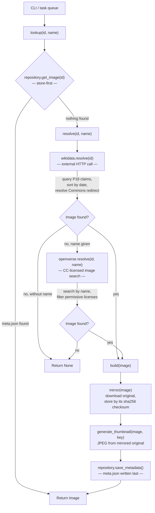

# Resolution flow

## Build flow

## Store as single source of truth

There is no separate cache layer and no api. The store (`FTM_ASSETS_STORE_URI`) holds everything and is meant to be served statically:

- `img/{id}/meta.json` — full `Image` model (attribution, alt text, relative urls)
- `img/{id}/{sha256}{ext}` — mirrored original image, by its sha256 checksum (with the file extension of its source)
- `img/{id}/thumbs/{size}.jpg` — generated thumbnail

`url` and `thumbnail_url` in `meta.json` are relative to its location, `original_url` is the source of the original image (see [`meta.json` fields](../usage.md#metajson)).

`meta.json` is written last, so its presence means the image is complete. If mirroring or thumbnail generation fails, no `meta.json` is written and the image is resolved again on the next lookup.

On subsequent lookups for the same ID, `lookup()` finds the metadata in the store and returns immediately without calling Wikidata.

## Python reference

::: ftm_assets.logic
